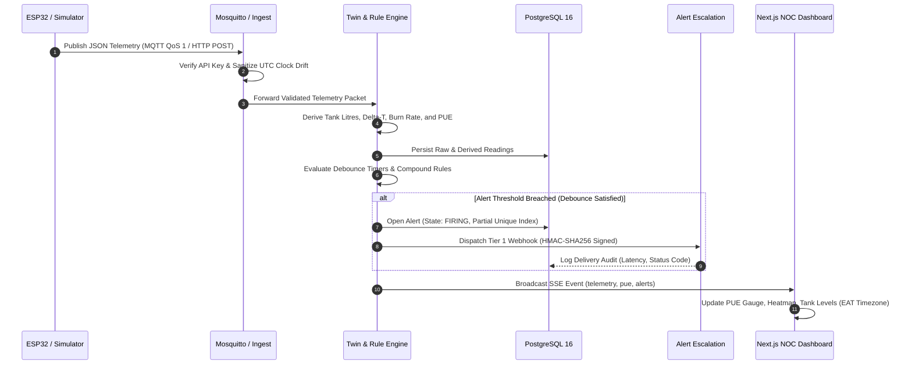

# ColdAisle: Data Hall Cooling & Power Telemetry Twin

[](https://www.typescriptlang.org/)
[](https://nextjs.org/)
[](https://nodejs.org/)
[](https://www.postgresql.org/)
[](https://mosquitto.org/)
[]()
[]()

> **Portfolio-Grade DCIM Telemetry & Digital Twin Platform**  
> Designed for mission-critical facilities, hyperscale data halls, and telecom power infrastructure in East Africa (*e.g., IXAfrica Data Centres, Huawei Digital Power, Camusat Kenya, Adrian Kenya*).

ColdAisle ingests physical sensor streams from edge microcontrollers (ESP32 / Wokwi) and facility simulators, derives real-time thermodynamic metrics and live **Power Usage Effectiveness (PUE)**, runs an alert engine with debouncing and deadband hysteresis, dispatches HMAC-signed multi-tier webhook escalations, and streams telemetry to an operations-grade NOC dashboard via Server-Sent Events (SSE).

---

## 1. System Architecture

ColdAisle is engineered as an event-driven, decoupled digital twin and DCIM telemetry pipeline. The platform separates raw physical edge ingestion from thermodynamic model computation, alert evaluation, and real-time visualization.

### 1.1 Architecture Topology

```
+──────────────────────────────────────────────────────────────────────────────────────────────────────────────────+
|                                              PHYSICAL & SIMULATION LAYER                                         |
|   [ Wokwi ESP32 Cloud Twin ]                [ Software Scenario Simulator ]          [ Physical ESP32 Edge HW ]  |
|   (2x DHT22, 2x Sonar, 2x Pots)             (7 Deterministic Fault Scenarios)        (Microcontroller & Sensors) |
+───────────────────────┬───────────────────────────────────┬──────────────────────────────────────┬───────────────+
                        │ MQTT (QoS 1)                      │ MQTT (QoS 1)                         │ HTTP Failover
                        ▼                                   ▼                                      │
+───────────────────────────────────────────────────+                                              │
|                INGESTION BROKER                   |                                              │
|   Mosquitto v2 (Local) / HiveMQ Cloud (Sandbox)   |                                              │
|   Topic: dcim/{site}/{hall}/{device}/telemetry    |                                              │
+───────────────────────┬───────────────────────────+                                              │
                        │ MQTT Subscribe                                                           │
                        ▼                                                                          │
+──────────────────────────────────────────────────────────────────────────────────────────────────┼───────────────+
|                                    INGEST & TWIN ENGINE (apps/ingest)                            ▼               |
|  ┌────────────────────────────────────────────────┐     ┌─────────────────────────────────────────────────────┐  |
|  │            Ingress Gateway & Auth              │     │                  HTTP Ingest API                    │  |
|  │  - MQTT Client (mqtt.js)                       │     │  - POST /api/v1/ingest                              │  |
|  │  - Timing-Safe SHA-256 API Key Verification    │◄────┤  - Header: X-Device-Key                             │  |
|  │  - Rate Limiting & Packet Sanitization         │     │  - Clock-drift Sanity Normalization (±5 min)        │  |
|  └───────────────────────┬────────────────────────┘     └─────────────────────────────────────────────────────┘  |
|                          │ Validated Telemetry Packet                                                            |
|                          ▼                                                                                       |
|  ┌────────────────────────────────────────────────┐     ┌─────────────────────────────────────────────────────┐  |
|  │           Physics Derivation Engine            │     │                Dynamic PUE Model                    │  |
|  │  - Ultrasonic cm -> Tank Fill % & Litres       │────>│  - Dynamic Chiller Lift & COP Curve                 │  |
|  │  - Thermal Differential (Delta-T = Thot - Tcold)│     │  - Double-Conversion UPS Efficiency Loss (η = 94%)  │  |
|  │  - Fuel Burn Rate & Generator Runtime Hours    │     │  - Rolling PUE FIFO Moving Window                   │  |
|  └───────────────────────┬────────────────────────┘     └──────────────────────────┬──────────────────────────┘  |
|                          │                                                         │                             |
|                          ▼                                                         ▼                             |
|  ┌────────────────────────────────────────────────────────────────────────────────────────────────────────────┐  |
|  │                                      Rule Engine & State Machine                                           │  |
|  │  - Multi-Threshold Comparator (Warn / Critical)                                                            │  |
|  │  - Debounce Window (for_seconds Breach Hold) & Deadband Hysteresis Recovery                                │  |
|  │  - Compound CDU Leak Detector (dP/dt Negative Gradient + dLevel/dt Fluid Drop)                             │  |
|  │  - Device Staleness Watchdog (3x Warning / 10x Critical Heartbeat Timeout)                                 │  |
|  └───────────────────────┬─────────────────────────────────────────────────────────┬──────────────────────────┘  |
|                          │ Trigger Escalation Event                                │ Broadcast Event             |
|                          ▼                                                         ▼                             |
|  ┌────────────────────────────────────────────────┐     ┌─────────────────────────────────────────────────────┐  |
|  │            Escalation Policy Runner            │     │                 Real-Time SSE Hub                   │  |
|  │  - Tier 1: Immediate (0s) -> On-Call Slack/SMS │     │  - GET /api/v1/stream                               │  |
|  │  - Tier 2: +5 min Unacked -> Duty Manager      │     │  - Broadcasts: telemetry, pue, alerts, health       │  |
|  │  - Tier 3: +15 min Unacked -> Incident Bridge  │     │  - Heartbeat & Automatic Reconnect Keep-Alive       │  |
|  │  - Outbound HMAC-SHA256 Request Signing        │     │                                                     │  |
|  └───────────────────────┬────────────────────────┘     └──────────────────────────┬──────────────────────────┘  |
+──────────────────────────┼─────────────────────────────────────────────────────────┼─────────────────────────────+
                           │ Audit Log & Persistence                                 │ Server-Sent Events (SSE)
                           ▼                                                         ▼
+───────────────────────────────────────────────────+     +─────────────────────────────────────────────────────+
|               POSTGRESQL 16 DATABASE              |     |               NOC DASHBOARD (apps/web)              |
|  - Raw & Derived Readings (Time-bucketed queries)  |     |  Next.js 14 App Router, Dark NOC Theme, Recharts    |
|  - Alert State (Firing / Acknowledged / Resolved) |     |  - Overview (Radial PUE Gauge & 1h Trendline)       |
|  - Partial Unique Deduplication Index             |     |  - Hall View (12-Rack Thermal & Power Heatmap)      |
|  - Webhook Delivery Attempts & Audit History      |     |  - Cooling (CDU Tank Graphic & Pressure Chart)      |
|  - Asset Geometry & Alert Threshold Configuration |     |  - Power (Diesel Tank, Genset, PUE Breakdown)       |
|  - Pure UTC Storage (Africa/Nairobi Presentation) |     |  - Alerts, Devices, Settings & Scenario Control     |
+───────────────────────────────────────────────────+     +─────────────────────────────────────────────────────+
```

---

### 1.2 Architectural Layers & Component Responsibilities

The ColdAisle codebase is partitioned into five distinct operational tiers:

| Tier | Component | Primary Responsibility | Protocols & Invariants |
|---|---|---|---|
| **1. Physical Edge & Simulation** | `/firmware`<br>`/sim` | Samples physical environmental sensors; executes failover; simulates facilities fault profiles | MQTT (QoS 1), HTTP POST failover; 5 s cadence; Wokwi cloud & hardware compatible |
| **2. Transport & Security** | `apps/ingest` | Terminates broker streams; verifies device authenticity; sanitizes timestamp drift | Timing-safe HMAC SHA-256; drift clamp to $\pm 300\text{ s}$; rate-limited ingress |
| **3. Thermodynamic Twin Engine** | `apps/ingest/src/engine` | Converts raw distance/voltage into facility metric twins; calculates dynamic facility PUE | Ultrasonic headspace $\rightarrow$ geometry volume; dynamic Chiller COP; $\eta_{\text{UPS}} = 94\%$ |
| **4. Operational Intelligence & Escalation** | `apps/ingest/src/engine`<br>`apps/ingest/src/escalation` | Evaluates debounced rules; flags compound leaks; manages alert state; dispatches signed webhooks | Debounce hold (`for_seconds`); hysteresis deadband; HMAC-SHA256 signature; exponential retry |
| **5. Storage & NOC Presentation** | `db`<br>`apps/web` | Persists time-bucketed readings; renders NOC dark dashboard; streams live metrics to operators | PostgreSQL 16 (UTC); Server-Sent Events (SSE); Next.js 14; Africa/Nairobi (EAT) display |

---

### 1.3 End-to-End Telemetry Pipeline



---

### 1.4 Monorepo Workspace Organization

```
coldaisle/
├── apps/
│   ├── web/                    # Next.js 14+ App Router NOC dashboard (Port 3000)
│   │   ├── src/app/            # 8 dedicated NOC routes (Overview, Hall, Cooling, Power, Alerts, Devices, Settings, Scenario)
│   │   ├── src/components/     # NOC dark theme widgets, radial gauges, and heatmaps
│   │   ├── src/context/        # RBAC security context (Admin Operator vs Read-Only Viewer)
│   │   └── src/hooks/          # useSSE real-time streaming hook with auto-reconnect
│   └── ingest/                 # Node.js 20+ Ingest & Twin Engine (Port 4000)
│       ├── src/engine/         # Physical derivation, dynamic PUE model, debounce, hysteresis, and compound rules
│       ├── src/escalation/     # HMAC-SHA256 signer, multi-tier policy runner, retry loop, and format adapters
│       ├── src/http/           # HTTP ingestion routes, alerts API, mock on-call sink, and SSE endpoint
│       ├── src/mqtt/           # Resilient MQTT client, topic dispatcher, and auto-recovery
│       └── tests/              # 37 Vitest unit tests covering rules, PUE, firmware, and webhooks
├── sim/                        # Standalone facility scenario simulator
│   ├── src/scenarios/          # 7 failure models (thermal spike, CDU leak, power cut, fuel depletion, etc.)
│   └── src/cli.ts              # Interactive CLI simulator runner with hotkey scenario switching
├── firmware/                   # ESP32 physical twin for Wokwi and DevKit hardware
│   ├── sketch.ino              # Arduino C++ application (WiFi, SNTP, PubSubClient, ArduinoJson, HTTP failover)
│   ├── diagram.json            # Wokwi canvas schematic with 2x DHT22, 2x HC-SR04, and 2x Potentiometers
│   └── libraries.txt           # Pinned dependencies for Wokwi compiler
├── db/                         # Database migrations and seed datasets
│   ├── migrations/             # Idempotent DDL schema (10 tables, time-series indexes, partial unique index)
│   └── seed/                   # Nairobi DC1 (Sameer Africa) campus topology, halls, racks, and default policies
├── docs/                       # Engineering specifications & runbooks
│   ├── architecture.md         # Deep-dive system architecture specification
│   ├── pue-model.md            # Mathematical formulation of facility PUE and chiller COP lift
│   ├── runbook.md              # Standard Operating Procedures (SOP) for on-call engineers
│   ├── demo-script.md          # 3-minute executive walkthrough script for Kenya DC operators
│   └── deploy-guide.md         # 100% free-tier cloud deployment guide (Neon + Render + Vercel)
├── docker-compose.yml          # Local infra orchestration (PostgreSQL 16 & Mosquitto 2 broker)
├── .env.example                # Documented configuration template
└── README.md                   # Project master overview
```

---

## 2. Sensor Model: Physical Transducers vs. Derived Facility Metrics

Edge controllers measure raw electrical voltages, resistances, and acoustic echo times. They **cannot** directly measure liquid volume, runtime hours, or PUE. ColdAisle strictly separates transducer inputs from server-side facility physics:

| Physical Sensor (ESP32 / Wokwi) | Transducer Channel | Physical Quantity | Derived Facility Metric (Server-side) |
|---|---|---|---|
| **HC-SR04 #1** | Pins 18 (Trig) / 19 (Echo) | Headspace distance (cm) | Cooling reservoir fill `%` and volume `litres` (via asset geometry) |
| **HC-SR04 #2** | Pins 21 (Trig) / 22 (Echo) | Headspace distance (cm) | Diesel day-tank fill `%`, volume `litres`, and remaining generator runtime `hours` |
| **DHT22 #1** | Pin 4 (1-Wire SDA) | Resistance / Capacitance | Cold-aisle containment inlet air temperature (°C) & relative humidity (%RH) |
| **DHT22 #2** | Pin 16 (1-Wire SDA) | Resistance / Capacitance | Hot-aisle exhaust air temperature (°C) & humidity (%RH); hot/cold $\Delta T$ |
| **Potentiometer #1** | Pin 34 (ADC1_CH6) | 0.0 to 3.3V analog input | Secondary coolant loop hydraulic pressure (0.0 to 4.0 bar) |
| **Potentiometer #2** | Pin 35 (ADC1_CH7) | 0.0 to 3.3V analog input | Active rack IT load (0.0 to 15.0 kW) |

### PUE Formulation
$$\text{PUE} = \frac{P_{\text{total}}}{P_{\text{IT}}} = \frac{P_{\text{IT}} + P_{\text{cooling}} + P_{\text{ups\_loss}} + P_{\text{aux}}}{P_{\text{IT}}}$$
- **$P_{\text{IT}}$**: Summed rack loads ($0 - 15\text{ kW}$ per rack).
- **$P_{\text{cooling}}$**: Base CDU pumps ($3.2\text{ kW}$) + dynamic chiller compressor work modelled from thermal lift $\Delta T$ and Chiller $\text{COP} = 3.6 - 0.04 \times (T_{\text{cold}} - 22)$.
- **$P_{\text{ups\_loss}}$**: Double-conversion UPS losses based on nominal $\eta = 94\%$.
- **$P_{\text{aux}}$**: Fixed facility lighting and monitoring overhead ($4.5\text{ kW}$).

*Detailed thermodynamic formulation: [`docs/pue-model.md`](docs/pue-model.md).*

---

## 3. Telemetry Contract

**MQTT Topic:** `dcim/{site}/{hall}/{device}/telemetry` (QoS 1)  
**HTTP Ingest:** `POST /api/v1/ingest` (Headers: `X-Device-Key: <key>`, `Content-Type: application/json`)

```json
{
  "device": "wokwi-esp32-01",
  "ts": "2026-11-08T12:00:00Z",
  "readings": {
    "cold_aisle_temp_c": 22.4,
    "cold_aisle_rh": 46.0,
    "hot_aisle_temp_c": 35.1,
    "hot_aisle_rh": 28.0,
    "coolant_pressure_bar": 2.65,
    "cdu_reservoir_distance_cm": 14.2,
    "diesel_distance_cm": 31.0,
    "rack_it_kw": 7.8
  }
}
```

- **Validation Rules**: Finite numbers within physical boundaries, server-side clock fallback if drifted > 5 minutes, timing-safe SHA-256 API key hashing.

---

## 4. Quickstart (< 10 Minutes Setup)

### Prerequisites
- Node.js 20+ (LTS)
- Docker Desktop with Compose
- Git

### Step 1: Clone & Configure
```bash
git clone https://github.com/your-username/coldaisle.git
cd coldaisle
cp .env.example .env
npm install
```

### Step 2: Launch Local Infrastructure
Start PostgreSQL 16 and Mosquitto 2 broker:
```bash
docker-compose up -d
```

### Step 3: Run Database Migrations & Seed
Creates all 10 DCIM tables, compound indexes, alert rules, 3-tier escalation policy, and Nairobi DC1 assets:
```bash
npm run db:migrate
npm run db:seed
```

### Step 4: Run Tests
Execute the 37 Vitest unit tests covering physical derivations, PUE, debouncing, hysteresis, deduplication, and HMAC webhooks:
```bash
npm test
```

### Step 5: Start the Telemetry Ingest & Web Dashboard
In two terminal tabs:
```bash
# Terminal 1: Ingestion engine & SSE stream (Port 4000)
npm --workspace=@coldaisle/ingest run dev

# Terminal 2: Next.js NOC Dashboard (Port 3000)
npm --workspace=@coldaisle/web run dev
```

### Step 6: Start the Scenario Simulator
In a third terminal tab:
```bash
npm run sim
```

Open **`http://localhost:3000`** in your browser. You will see live telemetry streaming in real time!

---

## 5. Demonstration Scenarios

The simulator supports 7 physical fault scenarios triggerable from the CLI (`npm run sim -- set-scenario <id>`) or via the **Scenario Control** page (`/scenario`):

| Scenario ID | Name | Physical Mechanism | Expected Alert / Escalation |
|---|---|---|---|
| `normal` | **Normal Baseline** | Steady $22.4^\circ\text{C}$ supply, $2.6\text{ bar}$ pressure | Zero active alerts; PUE ~ 1.41 |
| `thermal_spike` | **CRAH Fan Trip** | Cold-aisle inlet surges towards $38^\circ\text{C}$ | `RULE_COLD_TEMP` (Warn $> 27^\circ\text{C}$ $\rightarrow$ Crit $> 32^\circ\text{C}$) |
| `cdu_leak` | **Compound CDU Leak** | Reservoir drops $> 2\%/\text{min}$ **AND** pressure $< 1.8\text{ bar}$ | **`RULE_CDU_LEAK_COMPOUND`** fires **30s before** tank empty |
| `power_cut` | **Mains Grid Outage** | Grid cut; 1,000 kVA genset picks up load | Diesel burn begins; fuel runtime counts down; PUE spike |
| `fuel_depletion` | **Fuel Starvation** | Accelerated fuel drain ($> 250\text{ L/h}$) | `RULE_DIESEL_LEVEL` (Warn $< 40\%$ $\rightarrow$ Crit $< 20\%$) |
| `sensor_dropout` | **Edge Controller Loss** | Device ceases heartbeats | `RULE_DEVICE_STALE` ($3\times$ warn, $10\times$ critical) |
| `recovery` | **Remediation** | Smooth asymptotic return to baseline | Hysteresis deadband clears; alerts auto-resolve |

---

## 6. Wokwi ESP32 Cloud Simulation

Wokwi simulates an ESP32 edge controller running in a sandboxed browser environment.

1. Open [Wokwi ESP32](https://wokwi.com/projects/new/esp32).
2. Paste the contents of:
   - [`firmware/sketch.ino`](firmware/sketch.ino) into the sketch editor.
   - [`firmware/diagram.json`](firmware/diagram.json) into the diagram tab.
   - [`firmware/libraries.txt`](firmware/libraries.txt) into the libraries tab.
3. Configure Ingest: Set `MQTT_URL=mqtt://broker.hivemq.com:1883` in `.env` and restart ingest.
4. Click **Play** in Wokwi.
5. Telemetry streams from Wokwi $\rightarrow$ HiveMQ $\rightarrow$ ColdAisle Ingest $\rightarrow$ Dashboard.
6. *Manual fault injection:* Turn Potentiometer #1 to drop coolant pressure, or adjust DHT22 temperature to breach the ASHRAE thermal envelope.

*Detailed firmware instructions: [`firmware/README.md`](firmware/README.md).*

---

## 7. Escalation Webhooks & HMAC Verification

Every outbound escalation alert request is signed with an HMAC-SHA256 signature header:
```http
POST /api/on-call-webhook HTTP/1.1
Content-Type: application/json
X-Signature: sha256=d2f1...84c9
X-Signature-Timestamp: 1731067200
```

### Verifying Signatures in Node.js / Python
```javascript
import crypto from 'node:crypto';

function verifyColdAisleWebhook(rawBody, signatureHeader, secret) {
  const [algo, signature] = signatureHeader.split('=');
  const hmac = crypto.createHmac('sha256', secret);
  hmac.update(rawBody);
  const expectedSignature = hmac.digest('hex');
  return crypto.timingSafeEqual(Buffer.from(signature), Buffer.from(expectedSignature));
}
```

The platform includes an in-app receiver at `/api/mock-oncall` with delivery audit logging (`webhook_deliveries`).

---

## 8. Portfolio Screenshots Checklist

When showcasing ColdAisle on LinkedIn or in technical portfolios:

- [ ] **Overview Page (`/`)**: Dark-theme NOC with radial PUE gauge (1.41), 1-hour trendline, and live device health strip.
- [ ] **Hall Thermal Heatmap (`/hall`)**: 12-rack containment grid showing temperature gradient across aisles.
- [ ] **Cooling View (`/cooling`)**: Graphic CDU reservoir visualizer with pressure history and compound leak badge.
- [ ] **Power & PUE View (`/power`)**: Diesel fuel tank visualizer, generator status, and 4-channel power allocation bar.
- [ ] **Alert Incident Feed (`/alerts`)**: Live filterable incident table with modal acknowledgment and webhook delivery audit log.
- [ ] **Scenario Control (`/scenario`)**: 7 failure injection cards with real-time feedback.
- [ ] **Wokwi Simulation Canvas**: Wiring diagram with ESP32 DevKit, DHT22s, ultrasonic sensors, and potentiometers.

---

## 9. Documentation Index

- [`docs/architecture.md`](docs/architecture.md): Deep-dive system architecture and data flow.
- [`docs/pue-model.md`](docs/pue-model.md): Thermodynamic formulation of PUE, COP curves, and auxiliary models.
- [`docs/runbook.md`](docs/runbook.md): Standard Operating Procedures (SOP) for on-call facility engineers.
- [`docs/demo-script.md`](docs/demo-script.md): 3-minute executive demo script for hiring managers in Kenya.
- [`docs/deploy-guide.md`](docs/deploy-guide.md): 100% free-tier deployment guide (Neon + Render + Vercel).
- [`docs/assumptions.md`](docs/assumptions.md): Engineering invariants and system constants.

---

## 10. License

MIT © 2026 Antigravity DCIM Engineering.
